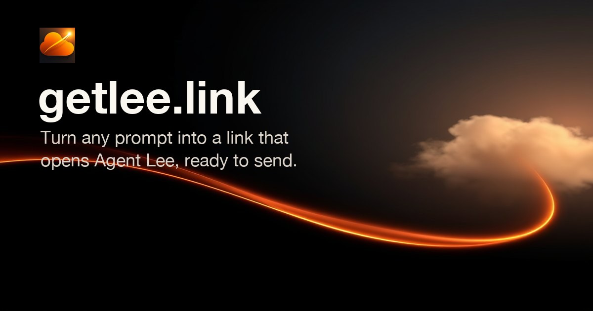

# getlee.link

Turn any prompt into a link that opens Cloudflare's Agent Lee with the prompt typed in, ready to send.



## What the link is

```
https://dash.cloudflare.com/?to=/:account#lee-draft=<encodeURIComponent(prompt)>
```

This is the shape the Cloudflare dashboard documents for external Lee drafts.

- Lee shows the prompt as an editable draft with the notice "Draft opened from a link. Review before sending." It never sends it alone.
- The prompt rides after the `#`. Browsers do not send that part to servers.
- A signed-out reader keeps the draft through sign-in for up to ten minutes.
- Empty prompts and prompts over 2,000 characters are dropped by the dashboard, so this site refuses to make them.
- The link carries plain text only. It cannot pick an account, a tool, permissions, or write mode.

## This site

A static Foldkit app (Effect 4, Tailwind 4) served by a Worker that only adds security headers. There is no backend and no analytics. The prompt you type lives in this page's own `#p=` fragment so you can share the editor.

## Run it

```
npm install
npm run dev          # http://localhost:8790
npm run check        # types, tests, build, lint rules
BASE=http://localhost:8790 npm run check   # plus the browser round-trip receipt
```

`receipts/round-trip.json` records the last browser run: the link shape, a decode of the exact prompt, the share URL, the 2,000 limit, and that no request carried the prompt.

## License

MIT
